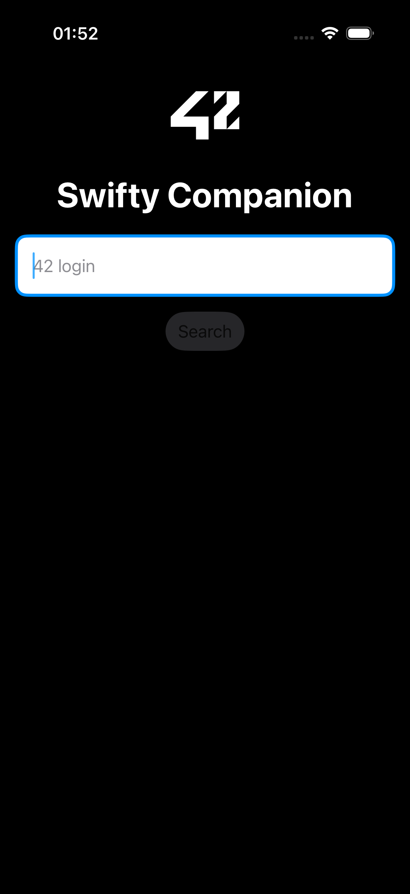

# Swifty Companion

An iPhone app built with Swift and SwiftUI. Type a login and it shows that person's public profile from the 42 network's API: photo, level, location, skills and project history.



## What it does

- Searches a profile by login
- Shows the photo, contact details, level, location, wallet and evaluation points
- Lists skills with their level and progress
- Lists completed and failed projects
- Handles the unhappy paths clearly: unknown login, network errors, missing data
- Adapts to any iPhone or iPad screen

## How it's built

- Swift and SwiftUI (iOS 17+), MVVM
- OAuth2 client-credentials flow with a cached token that refreshes itself when it expires, so a search never asks for a new token
- [XcodeGen](https://github.com/yonaskolb/XcodeGen) generates the Xcode project from `project.yml`

```
Sources/
  Models/       Codable structs for the API's JSON (User, Skill, ProjectUser, ...)
  Networking/   TokenManager (cached OAuth2 token) and APIClient
  ViewModels/   Screen state and logic
  Views/        SwiftUI screens (SearchView, ProfileView)
  Config/       Secrets.swift (gitignored, holds the API credentials)
```

## Run it

1. Register an app at [profile.intra.42.fr/oauth/applications](https://profile.intra.42.fr/oauth/applications) (scope `public`) to get a UID and a secret.
2. Copy `Sources/Config/Secrets.swift.example` to `Sources/Config/Secrets.swift` and fill in your UID and secret. The file is gitignored.
3. Install XcodeGen (`brew install xcodegen`) and run `xcodegen generate` in the project folder.
4. Open `SwiftyCompanion.xcodeproj` in Xcode and run it on the iOS Simulator.

The API fields the app relies on are listed in [`docs/42-api-reference.md`](docs/42-api-reference.md).
